# UWB-based Indoor Positioning Using Deep Learning

딥러닝을 활용한 UWB 기반 실내 측위 연구


## Overview

- UWB 측위를 위한 딥러닝 기법 연구
- HW(삼변측량)와 AI(DNN, LSTM)의 측위 성능 비교
- 임베디드 시스템 설계: DWM-1001을 이용한 AI 모델 실시간 추론

**주요 결과:** 실측 데이터 기준 MSE가 삼변측량 0.0421에서 LSTM 0.0016으로 감소했다.

연구 환경은 다음 논문을 참고하여 설정했다.

1. [Accurate Indoor Positioning for UWB-Based Personal Devices Using Deep Learning](https://ieeexplore.ieee.org/document/10054386)
2. [Research on UWB positioning trajectory prediction based on LSTM](https://ieeexplore.ieee.org/document/9512882)
3. [UWB Indoor Localization Using Deep Learning LSTM Networks](https://www.mdpi.com/2076-3417/10/18/6290)

후속 연구: [UWB-NLoS-LoS-Classification-for-KF](https://github.com/ChoeHyeongSoo/UWB-NLoS-LoS-Classification-for-KF) (CIR 기반 LoS/NLoS 분류, 칼만 필터 보정)

## Contents

1. [Theory](#1-theory)
2. [Dataset](#2-dataset)
3. [Simulation](#3-simulation)
4. [Real-Time Embedded System](#4-real-time-embedded-system)
5. [Insight](#5-insight)
6. [Getting Started](#getting-started)
7. [Repository Structure](#repository-structure)
8. [References](#references)

## 1. Theory

- **ToA (Time of Arrival)**: 신호의 도달 시간으로, 거리 = ToA × c(광속)이다. DWM-1001은 DS-TWR(Double-Sided Two-Way Ranging) 방식으로 앵커–태그 간 거리를 측정한다.
- **삼변측량 (Trilateration)**: 3개 이상의 앵커까지의 거리로 그린 원의 교점에서 위치를 계산한다. 거리 측정값의 오차가 위치 오차로 그대로 전파되므로, 측정 잡음이나 NLoS 환경에서 오차가 커진다.
- **딥러닝 접근**: 측정값을 보정하는 대신 ToA로부터 위치를 직접 예측한다. DNN은 ToA와 좌표 사이의 비선형 관계를 학습하고, LSTM은 연속된 측정 시퀀스의 시간적 패턴까지 반영한다.

## 2. Dataset

| 항목 | 값 |
|---|---|
| 앵커 좌표 (x, y, z) [m] | (0, 0, 2.02), (0, 6.48, 2.02), (4, 0, 2.02), (4, 6.48, 2.02) |
| 측정값 | ToA = 거리 / c(광속) + 잡음 |
| 태그 이동 범위 | x ∈ (0.97, 3.06), y ∈ (1.62, 4.62) |
| 데이터 수 | 원시 측정 26,714건 → 이상치 897건 제거 → 25,818건 (테스트셋 20%, 5,164건) |

DWM-1001로 측정한 ToA는 잡음 정보를 알 수 없어, 각 ToA에 대응하는 정답 좌표를 직접 특정할 수 없다. 따라서 모듈이 추정한 좌표로 Ground Truth(태그 이동 범위로 만든 사각형)를 생성하고, ToA와 Ground Truth 좌표를 매핑하여 학습한다.

### 2.1 UWB ToA

모듈은 태그에서 앵커 4개까지의 거리를 출력한다. ToA = 거리 / c 이므로 이를 ToA로 변환하여 학습 입력으로 사용한다.

| 그림 1. 이상치를 제거한 앵커–태그 거리 데이터 | 그림 2. ToA 변환 (거리 / c) |
|:---:|:---:|
| 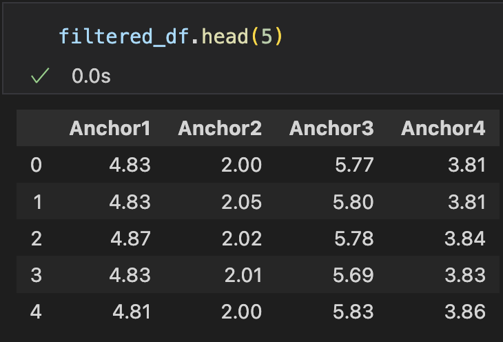 | 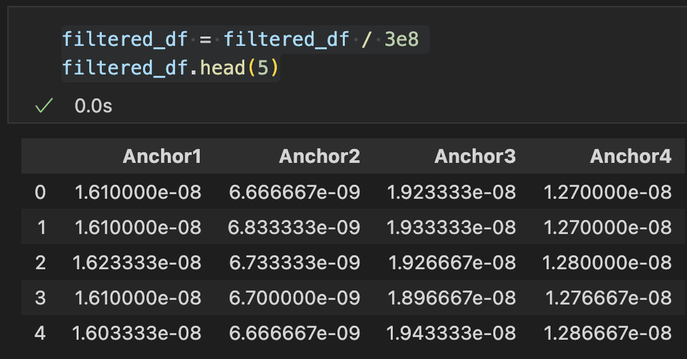 |

### 2.2 Data Processing

DWM-1001로 측정한 데이터는 환경에 따라 잡음을 가지며, 그 크기를 알 수 없다. 따라서 측정 데이터의 평균과 분산을 이용해 Ground Truth를 설정하고, 이를 학습 데이터의 정답 레이블로 지정한다. 실험 환경에서 직접 설정한 Ground Truth 좌표는 다음과 같다.

```python
ground_truth = [
    [0.8, 4.88],  # Point 1
    [0.8, 1.6 ],  # Point 2
    [3.2, 1.6 ],  # Point 3
    [3.2, 4.88],  # Point 4
]
```

1. 모듈이 추정한 좌표를 클러스터링하여 이상치를 제거한다.
2. 이상치를 제거한 좌표와 ToA를 인덱스로 매칭하여 저장한다.
3. 5% 오차 범위(사각형 기준 ±2.5%) 안의 데이터만 학습에 사용한다.
4. 필터링된 ToA–거리 데이터와 Ground Truth 좌표를 인덱스에 따라 매칭하여 저장한다.

| 그림 3. DWM-1001(삼변측량)이 추정한 원시 좌표 | 그림 4. 클러스터링을 통한 이상치 탐지 |
|:---:|:---:|
| 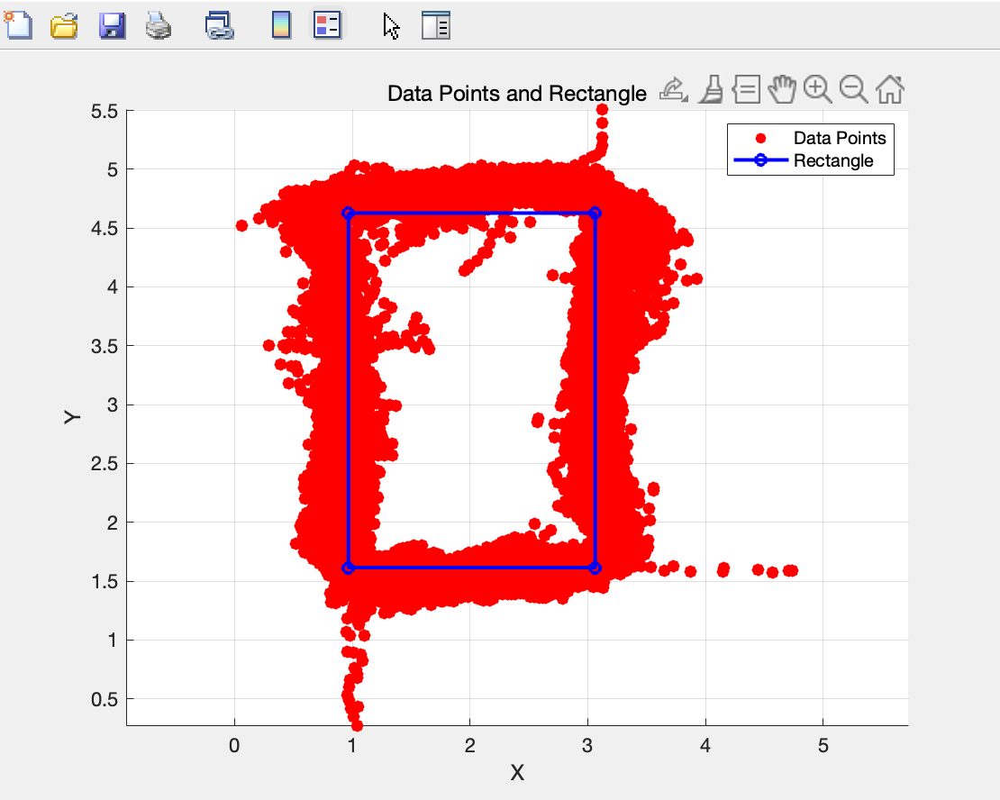 | 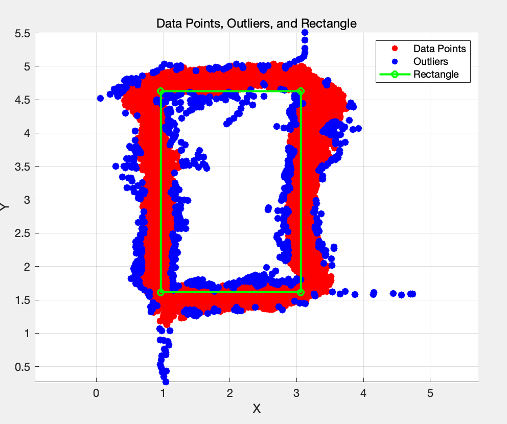 |
| **그림 5. 이상치를 제거한 좌표** | **그림 6. 5% 오차 범위로 제한한 데이터** |
| 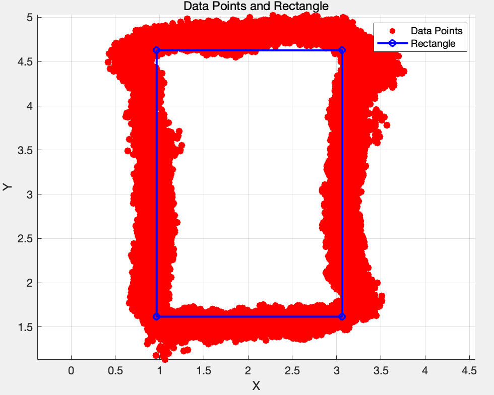 | 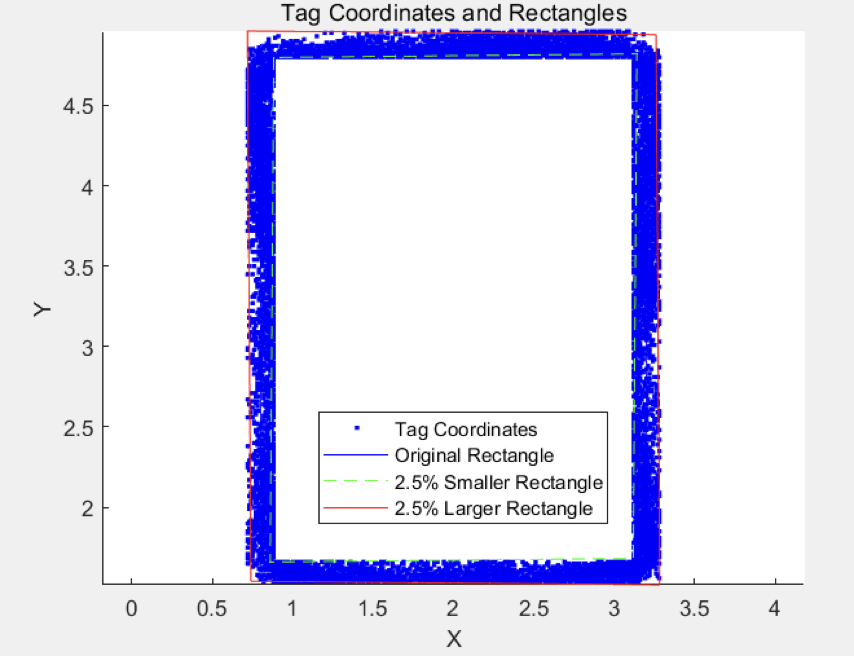 |

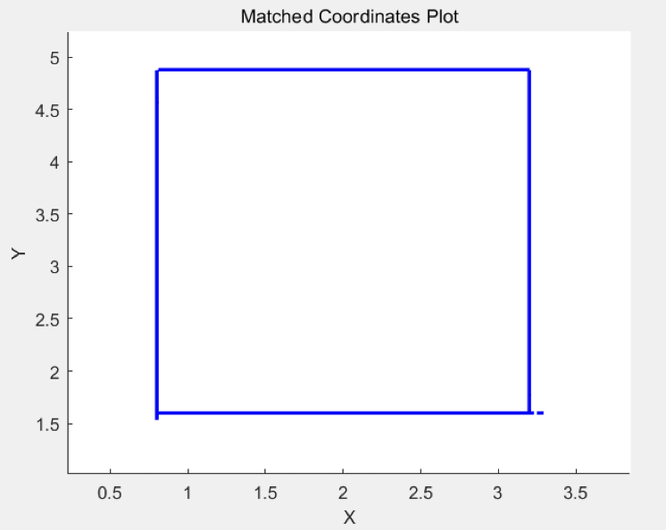

*그림 7. ToA–거리–좌표 매칭 결과*

### 2.3 MATLAB Data

측정 잡음으로 인해 DWM-1001로 추출한 데이터는 신뢰도가 낮고, 그 오차 범위를 특정할 수 없다. 따라서 다양한 경로와 일반성을 확보하기 위해 MATLAB으로 데이터를 생성하여 실험한다.

- 데이터 포인트 10개를 한 샘플로 하여 10,000개 샘플 생성
- 속도 1.5 m/s(사람의 평균 보행 속도), 방향은 랜덤, 동일한 시간 간격

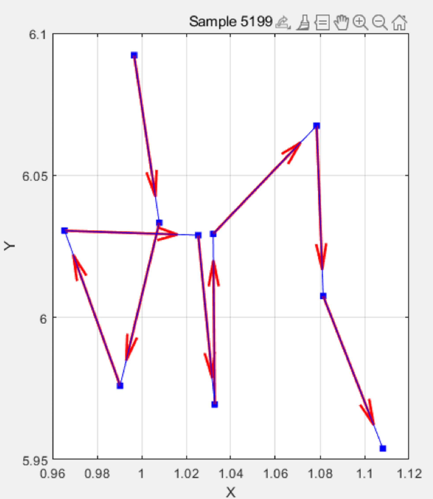

*그림 8. 샘플 데이터 (데이터 포인트 10개)*

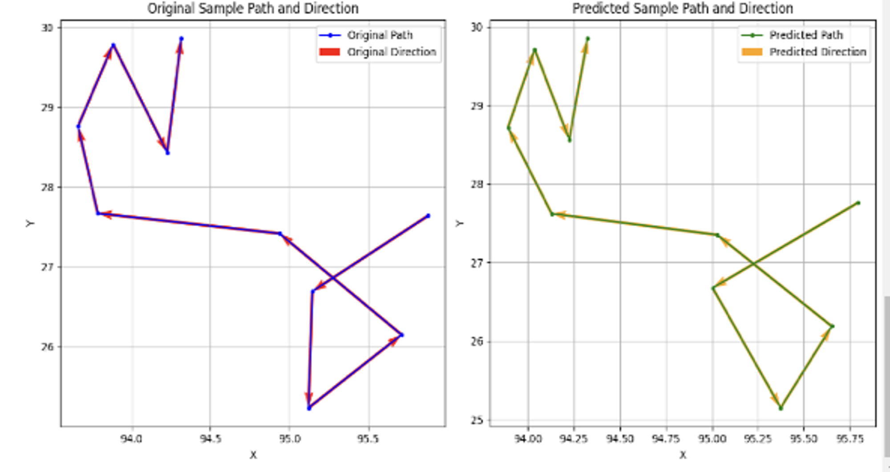

*그림 9. 동일 조건, 1 s 시간 간격에서의 Tracking*

시간 간격이 길수록 Tracking이 정밀해진다. 하지만 DWM-1001로 측정한 데이터는 약 0.4 s의 시간 간격을 가지므로, 파라미터 튜닝과 모델 구조 변경으로 성능을 개선한다.

또한 비교를 위해 데이터 포인트 100개를 가진 샘플 1,000개로도 학습한다. 속도는 동일하며, 방향에 대한 제한만 추가했다.

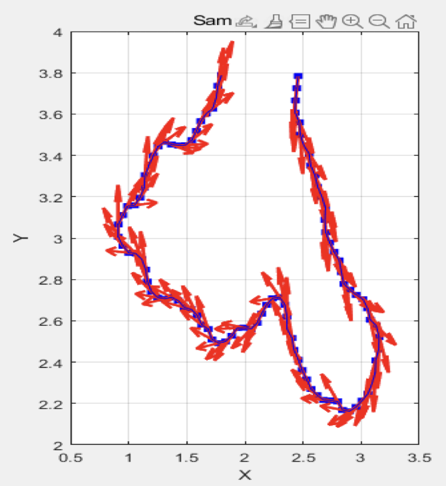

*그림 10. 데이터 포인트 수와 방향을 제한한 테스트 데이터*

## 3. Simulation

DWM-1001로 측정한 ToA로 위치를 예측하고, MSE를 지표로 HW(삼변측량)와 AI(DNN, LSTM)의 성능을 비교한다.

| 모델 | 구조 | Epochs | LR | Batch |
|---|---|:---:|:---:|:---:|
| DNN | FC 128 → ReLU → FC 2 | 1000 | 0.001 | 64 |
| LSTM | LSTM(128) → Dropout(0.5) → LSTM(128) → Dropout(0.5) → FC 2, 시퀀스 길이 10 | 100 | 0.001 | 64 |

학습/테스트 비율은 80 : 20이다. MSE는 각 예측 좌표에서 Ground Truth 사각형 위의 가장 가까운 점까지 거리의 제곱 평균으로 계산한다.

| 그림 11. DNN 시뮬레이션 | 그림 12. LSTM 시뮬레이션 |
|:---:|:---:|
| 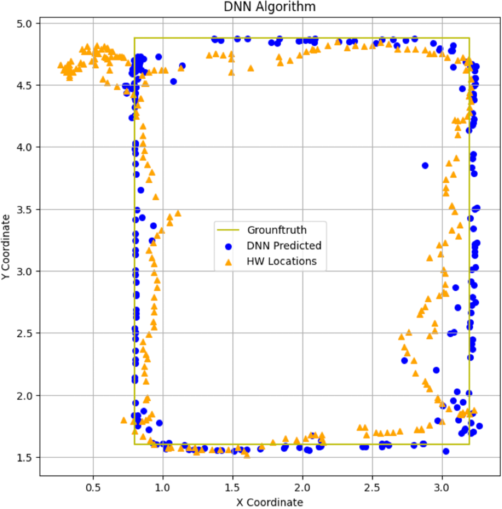 | 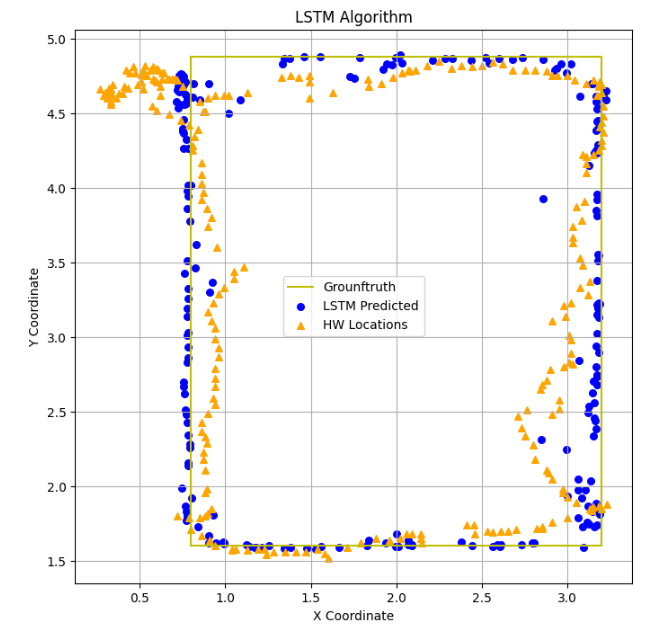 |

| 알고리즘 | 삼변측량 | DNN | **LSTM** |
|---|:---:|:---:|:---:|
| MSE | 0.0421 | 0.0021 | **0.0016** |

## 4. Real-Time Embedded System

### 4.1 Algorithm

1. DWM-1001 모듈로 구성한 앵커–태그 연결 설정을 Ebterminal로 수정하여 연구 환경과 동일하게 맞춘다.
2. 포트(115200 baud)에 연결된 태그를 통해 각 앵커까지의 거리 정보를 추출한다. 모든 거리 정보가 동시에 추출되지 않으면 해당 입력은 버린다.
3. Python으로 Serial 통신을 제어한다. 실시간으로 추출한 거리 정보를 길이 10의 시퀀스로 만들어 LSTM의 입력으로 사용한다.
4. 모듈의 예측값과 LSTM의 예측값을 함께 Plot하여 Tracking 과정을 관찰한다.

### 4.2 Result

실시간 측위 테스트 영상을 첨부할 수 없어, 실행 화면 일부를 캡처하여 첨부한다.

| 그림 13. 실시간 좌표 예측 (1) | 그림 14. 실시간 좌표 예측 (2) |
|:---:|:---:|
| 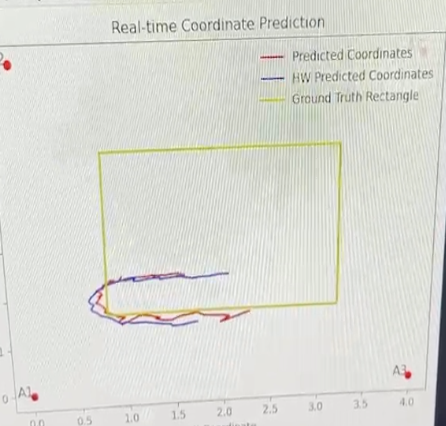 | 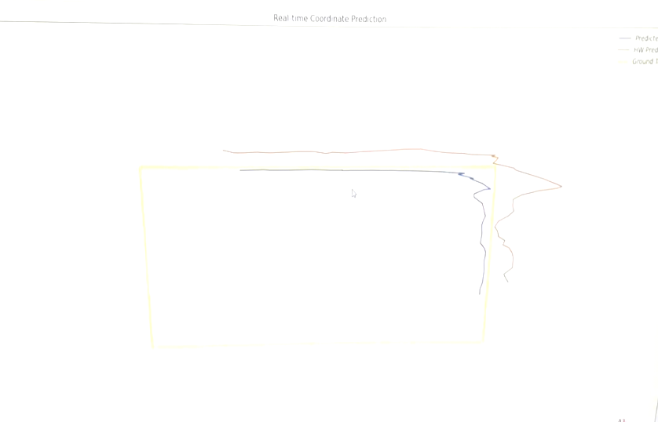 |

## 5. Insight

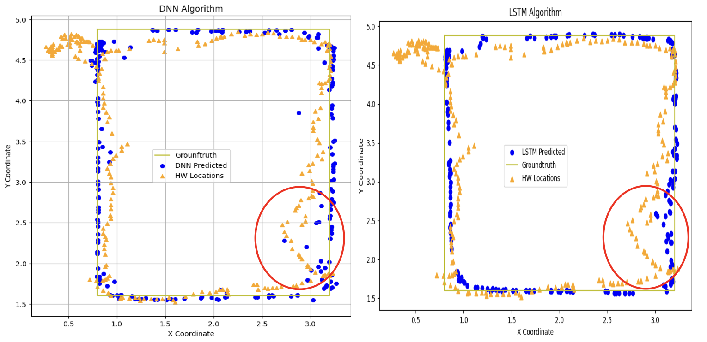

*그림 15. 알고리즘별 테스트 결과*

| 알고리즘 | 삼변측량 (MATLAB) | 삼변측량 (Hardware) | LSTM (MATLAB) | LSTM (Hardware) |
|---|:---:|:---:|:---:|:---:|
| MSE | 0.34 | 0.0421 | 0.15 | 0.0024 |

원으로 표시한 구간에서 HW 위치는 Ground Truth에서 안쪽으로 벗어나지만, DNN과 LSTM의 예측은 Ground Truth 근처에 유지된다. 특히 시퀀스의 시간적 패턴을 활용하는 LSTM이 DNN보다 Ground Truth에 더 가깝게 예측한다.

## Getting Started

### Requirements

- Python 3, PyTorch, scikit-learn, pandas, NumPy, SciPy, Matplotlib, pyserial
- MATLAB (데이터 생성, 전처리, 삼변측량)
- 실시간 추론: DWM-1001 모듈 (앵커 4개, 태그 1개)

```bash
pip install torch scikit-learn pandas numpy scipy matplotlib pyserial
```

### Run

```bash
# DNN 학습 (레포 루트에서 실행, 가중치는 UWB_Positioning/HW/hw_filtered_dnn.pth에 저장)
python UWB_Positioning/HW/HW_DNN.py

# DNN 테스트 (HW 원시 데이터와 비교)
python UWB_Positioning/HW/HW_test_DNN.py

# LSTM 학습 (groundtruth.csv, filtered_distance.csv, TOA.csv, Loc.csv를 현재 폴더에서 읽고 lstm_model.pth 저장)
python HW_LSTM.py

# 실시간 추론 (lstm_model.pth 필요, 코드의 port = "COM4"를 태그가 연결된 포트로 수정)
python Real-time_Embedded.py
```

## Repository Structure

```
UWB_Positioning/
├── dataset_fixed coordinates/   # MATLAB 고정 좌표 ToA 데이터 생성
├── Static/Model/                # 고정 좌표 DNN (2D, 3D)
├── Dynamic/                     # MATLAB 이동 경로 데이터 생성, LSTM Tracking
├── HW/                          # DWM-1001 실측 데이터 전처리(MATLAB), DNN·LSTM 학습, 실시간 추론
│   ├── data/                    # 원시·필터링 데이터, 테스트셋
│   ├── HW_DNN.py / HW_test_DNN.py
│   ├── HW_LSTM.py
│   └── Real-time_Embedded.py
└── Trilateration/               # 삼변측량 (MATLAB)
```

## References

1. [Accurate Indoor Positioning for UWB-Based Personal Devices Using Deep Learning](https://ieeexplore.ieee.org/document/10054386)
2. [Research on UWB positioning trajectory prediction based on LSTM](https://ieeexplore.ieee.org/document/9512882)
3. [UWB Indoor Localization Using Deep Learning LSTM Networks](https://www.mdpi.com/2076-3417/10/18/6290)
